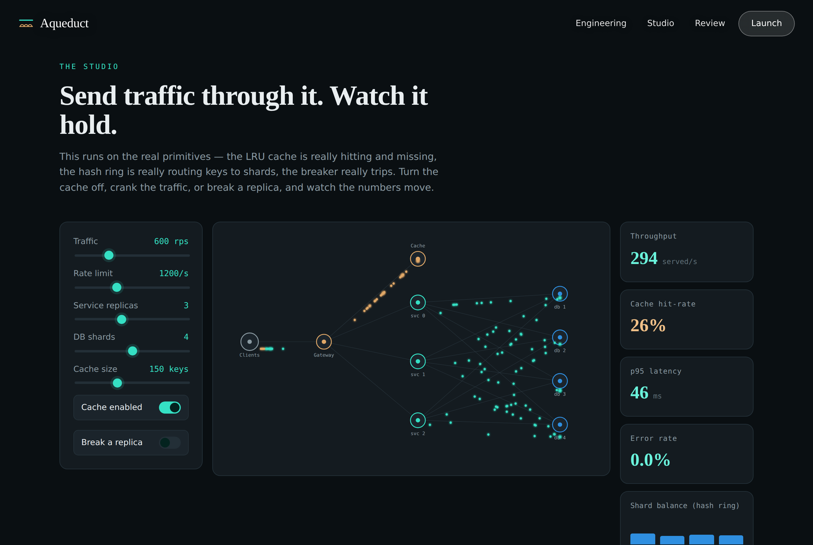
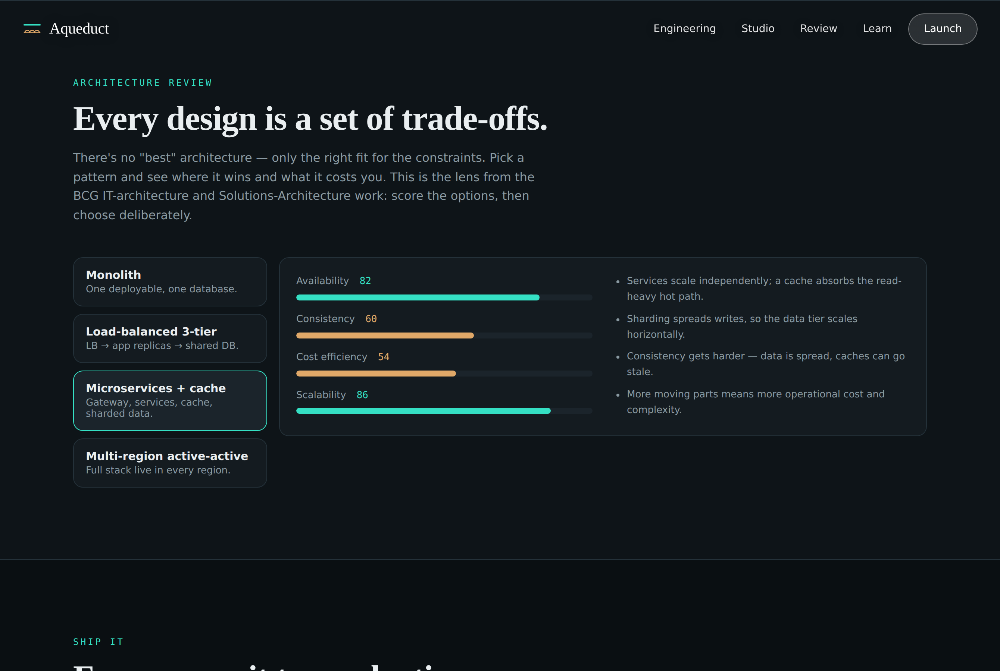

# Aqueduct

**A distributed-systems studio.** Compose a cloud architecture, send live traffic through it, and watch it cache, shard, autoscale and recover — all running on real primitives: a token-bucket rate limiter, an LRU cache, a consistent-hash ring and a circuit breaker, each implemented from scratch and unit-tested. An aqueduct carries flow across a structure at scale; so does a distributed system.

**Live:** https://aqueduct-nishant.netlify.app &nbsp;·&nbsp; **Author:** [Nishant Singh](https://nishant-singhaa0240274.netlify.app)



## What's inside

- **The studio** — a live simulation on a composable topology (clients → gateway → service replicas → cache → sharded DB). Turn the cache off, crank the traffic, change the shard count, or break a replica, and the metrics respond in real time: throughput, cache hit-rate, p95 latency, error rate, shard balance and replica load. The particles are real requests; the numbers come from the actual primitives running.
- **The engine room** — five distributed-systems primitives, built and tested:
  - **Priority queue** (binary heap) — the task scheduler
  - **LRU cache** — O(1) get/put with hit-rate tracking
  - **Token-bucket rate limiter** — the gateway's admission control
  - **Consistent-hash ring** — shards keys with ~1/N movement on scale-out
  - **Circuit breaker** — trips open on repeated failure, probes half-open, closes on success
- **Architecture review** — score four patterns (monolith → 3-tier → microservices+cache → multi-region) across availability, consistency, cost and scalability. The deliberate trade-off lens.
- **DevOps pipeline** — a commit-to-production delivery pipeline: build, test, containerize, provision (IaC), rolling deploy, observe.
- **Live backend** — the same primitives exposed as real endpoints (`/api/health`, `/api/ratelimit`, `/api/cache`, `/api/hashring`).



## The hero

The landing is a real-time WebGL fragment shader — domain-warped fractal noise flowing like deep water, bending toward the cursor — with editorial serif typography. It honours `prefers-reduced-motion`.

## Tech stack

TypeScript everywhere · React 18 + Vite · **Three.js** (WebGL fluid shader) · HTML5 Canvas (the traffic sim) · Netlify Functions (Node 22) · hand-built design system. No charting or UI library.

## The backend, honestly

The live backend runs on **Netlify Functions (Node/TypeScript)** so the whole site deploys in one step. The *same gateway* is also written in **Java / Spring Boot** under [`reference/springboot/`](reference/springboot/) — REST controllers, a thread-safe token bucket, constructor injection — the Scaler Spring Boot course stack, for roles that interview on the JVM. It builds and runs locally; it just isn't deployed with the static site (a JVM service needs its own host).

## What it demonstrates

| Area | Certification |
|---|---|
| Priority-queue scheduler, data structures | Walmart — Advanced Software Engineering |
| Microservice decomposition, the gateway | Skyscanner — Software Engineering |
| REST service + backend | HPE — Software Engineering; Scaler Spring Boot |
| Trade-off review (availability/consistency/cost/scale) | BCG — IT Architecture; Forage Solutions Architecture |
| Multi-cloud topology, autoscaling, sharding | Datacom — Introduction to Cloud |
| East-West routing, SDN/NFV framing | JNCIA-Cloud (Juniper) |
| CI/CD, containerize, IaC, rolling deploy | Udemy — DevOps |
| Rate limiting, caching, circuit breaking | Resilience patterns — beyond the coursework |

## Run it

```bash
npm install
npm run build
npx netlify dev          # http://localhost:8888
```

## Tests

```bash
npm test          # 28 checks
npm run typecheck # strict TypeScript
```

- **Unit** — the five primitives, including a consistent-hash ring verified to stay balanced and to move only ~1/N of keys when a node joins (an avalanche finalizer fixes the clustering that plain FNV-1a would cause on sequential keys).
- **Backend** — drives the Functions handler: the rate limiter throttling a burst, the cache hitting on the second read, the ring's distribution staying balanced.

CI runs typecheck, tests and build on every push (`.github/workflows/ci.yml`).

## Deploy on Netlify

Build command `npm run build`, publish directory `dist`. The functions in `netlify/functions/` are picked up automatically. No environment variables required.

## License

MIT © 2026 Nishant Singh.
